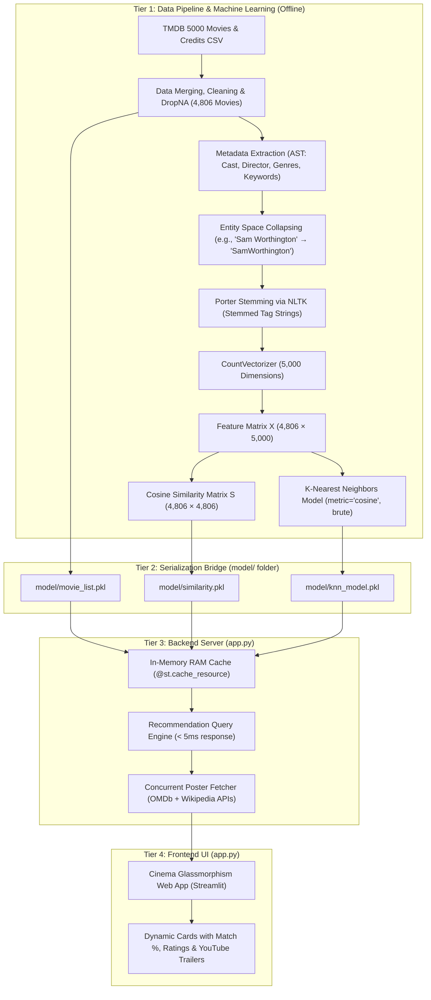

# 🎬 CineMatch AI: Complete Project Documentation

> **Project Title:** CineMatch AI — Content-Based Movie Recommendation System  
> **Author & Developer:** Nandini Mane  
> **Domain:** Machine Learning, Natural Language Processing (NLP) & Full-Stack Web Development  
> **Core Algorithm:** K-Nearest Neighbors (KNN) with Cosine Distance Vector Space Modeling  
> **GitHub Repository:** [Nandinimane511/movie-recommender-system](https://github.com/Nandinimane511/movie-recommender-system)  

---

## 📌 1. Project Overview

**CineMatch AI** is an intelligent, production-ready movie recommendation system developed using the **TMDB 5000 Movie Dataset** (4,800+ films).

### 💡 Why Content-Based Filtering?
Collaborative filtering systems require extensive user ratings and struggle when new users or items are introduced (the **"Cold-Start Problem"**). CineMatch AI eliminates this limitation by recommending movies strictly based on **semantic metadata similarity**:
- 📖 **Plot Synopses** (Thematic storyline overviews)
- 🎭 **Genre Classifications** (Action, Drama, Sci-Fi, Romance, etc.)
- 🏷️ **Plot Keywords** (Specific story tropes, e.g., "dystopia", "space travel")
- 🌟 **Top 3 Cast Members** (Lead billing actors)
- 🎬 **Film Directors** (Auteur/directorial style)

---

## 🏗️ 2. End-to-End System Architecture

The project is structured into **4 decoupled layers**:



---

## 📓 3. The Jupyter Notebook Guide (`Movie_Recommendation_System_EDA.ipynb`)

The entire machine learning experimentation, exploratory data analysis, and mathematical modeling pipeline is implemented in [Movie_Recommendation_System_EDA.ipynb](file:///d:/movie%20recommendation%20project/Movie_Recommendation_System_EDA.ipynb).

### 📋 Section-by-Section Summary

#### • Section 1: Library Ingestion & Dataset Loading
- Loads `tmdb_5000_movies.csv` (4,803 rows, 20 columns) and `tmdb_5000_credits.csv` (4,803 rows, 4 columns).
- Verifies shapes and initial column schemas.

#### • Section 2: Exploratory Data Analysis & Feature Correlation
- Computes **Pearson Correlation Coefficient ($r$)** across numerical features (`budget`, `popularity`, `revenue`, `runtime`, `vote_average`, `vote_count`).
- **Key Finding:** Budget and revenue exhibit strong correlation ($r = 0.73$), while critic rating (`vote_average`) is independent of budget ($r = 0.09$).
- Renders an annotated **Seaborn Blues Heatmap** embedded directly in the notebook output.

#### • Section 3: Dataset Merging & Index Alignment
- Inner-merges movies and credits on the `title` attribute.
- Filters nulls on key metadata columns and executes `df.reset_index(drop=True)` to ensure exact 1-to-1 index alignment with matrix coordinates (retaining **4,806** clean samples).

#### • Section 4: Metadata Parsing via AST
- Parses stringified JSON objects using `ast.literal_eval`.
- Extracts clean Python lists: Top 3 billed actors, the primary director, all genres, and all thematic keywords.

#### • Section 5: NLP Preprocessing & Unified Tag Construction
- **Space Collapsing:** Transforms `"Christopher Nolan"` $\rightarrow$ `"christophernolan"` to treat multi-word names as single semantic tokens.
- **Porter Stemming:** Uses NLTK's `PorterStemmer` so inflected words (`loved`, `loving`, `love`) converge to root `love`.
- Concatenates tokens into a single unified tag string per film.

#### • Section 6: Bag-of-Words Feature Matrix
- Uses `CountVectorizer(max_features=5000, stop_words='english')`.
- **Feature Matrix Shape:** $4,806 \text{ rows} \times 5,000 \text{ columns}$.
- **Non-zero counts:** $145,410$ terms.
- **Matrix Sparsity:** $99.39\%$ (demonstrates high semantic distinction among films).

#### • Section 7: Pairwise Cosine Similarity Matrix
- Computes pairwise cosine similarity matrix $\mathbf{S} \in [0, 1]^{4806 \times 4806}$.
- Verifies identity diagonal ($\mathbf{S}_{i,i} = 1.00$).
- Displays submatrix table and renders an annotated **Cosine Similarity Heatmap** across representative benchmark films.

#### • Section 8: K-Nearest Neighbors (KNN) Machine Learning Model
- Trains `NearestNeighbors(n_neighbors=6, metric='cosine', algorithm='brute')` on feature matrix $\mathbf{X}$.
- Implements `recommend_with_knn()`.
- Validates model inference with top-5 recommendations for *The Dark Knight*, *Interstellar*, and *The Avengers*.

#### • Section 9: Model Artifacts Export
- Serializes `model/movie_list.pkl`, `model/similarity.pkl`, and `model/knn_model.pkl` for immediate production use.

---

## 🤖 4. Machine Learning Model: K-Nearest Neighbors (KNN)

### ❓ What is the ML Model?
The system utilizes the **K-Nearest Neighbors (KNN)** algorithm (`sklearn.neighbors.NearestNeighbors`). In this unsupervised setting, KNN indexes 4,806 movies across a 5,000-dimensional metric space.

### 📐 Mathematical Formulation: Cosine Distance
Standard Euclidean distance ($L_2$ norm) fails in high-dimensional text vectors due to document length variations. KNN uses **Cosine Distance**:

$$\text{Cosine Distance } d(\vec{u}, \vec{v}) = 1.0 - \cos(\theta) = 1.0 - \frac{\vec{u} \cdot \vec{v}}{\|\vec{u}\| \|\vec{v}\|}$$

$$\text{Expanded: } d(\vec{u}, \vec{v}) = 1.0 - \frac{\sum_{k=1}^{5000} u_k \cdot v_k}{\sqrt{\sum_{k=1}^{5000} u_k^2} \cdot \sqrt{\sum_{k=1}^{5000} v_k^2}}$$

### 🔢 Similarity Percentage Conversion
$$\text{Match Percentage} = (1.0 - d(\vec{u}, \vec{v})) \times 100\%$$

### ⚙️ Model Hyperparameters
- **Algorithm:** `sklearn.neighbors.NearestNeighbors`
- **Metric:** `cosine` (angular distance bounded in $[0.0, 1.0]$)
- **Search Algorithm:** `brute` (computes exact, deterministic nearest neighbors)
- **Neighbors ($k$):** $6$ ($1$ query movie self-match $+$ $5$ recommendations)

---

## 🎯 5. Concrete Walkthrough Example: Querying *"The Dark Knight"*

To understand how mathematics converts user input into recommendations:

### 1. User Selection
The user chooses **"The Dark Knight"** (Index `idx = 65`).

### 2. Stemmed Tag Generation
```text
"batman rais the stake in his war on crime with the help of lt jim gordon 
and district attorney harvey dent batman set out to dismantl the remain crimin organ 
... christianbale heathledger aaroneckhart christophernolan"
```

### 3. Model Inference Execution
```python
query_vector = vectors[65].reshape(1, -1)
distances, indices = knn_model.kneighbors(query_vector, n_neighbors=6)
```

### 4. Generated Output

| Rank | Recommended Movie | Cosine Distance | Similarity Match % | TMDB Rating | Shared Content Attributes |
|:---:|---|:---:|:---:|:---:|---|
| **1** | **The Dark Knight Rises** | `0.5774` | **42.3%** | ⭐ 7.6 / 10 | Director (Nolan), Lead (Bale), DC Gotham universe |
| **2** | **Batman Begins** | `0.5978` | **40.2%** | ⭐ 7.5 / 10 | Origin story, Director (Nolan), Lead (Bale) |
| **3** | **Batman Returns** | `0.6686` | **33.1%** | ⭐ 6.6 / 10 | DC Comics, Gotham City vigilante, superhero crime |
| **4** | **Batman Forever** | `0.7059` | **29.4%** | ⭐ 5.2 / 10 | DC Comics, Gotham villains, Batmobile |
| **5** | **Batman** | `0.7233` | **27.7%** | ⭐ 7.0 / 10 | Classic Gotham lore, Joker adversary, Tim Burton |

---

## 🔌 6. Backend Integration (`app.py`)

The backend server is built using **Streamlit** and Python:

### 1. In-Memory RAM Caching (`@st.cache_resource`)
Re-training or re-calculating 4,806 vectors on every browser click would freeze the application. The backend uses Streamlit caching to load weights once:
```python
@st.cache_resource
def load_data():
    movies = pickle.load(open('model/movie_list.pkl', 'rb'))
    similarity = pickle.load(open('model/similarity.pkl', 'rb'))
    knn_model = pickle.load(open('model/knn_model.pkl', 'rb'))
    return movies, similarity, knn_model

movies, similarity, knn_model = load_data()
```

### 2. Sub-5 Millisecond Inference
Slicing `similarity[idx]` or executing `knn_model.kneighbors()` takes **less than 5 milliseconds** because the model is already memory-resident.

### 3. Concurrent Multi-Source Poster Pipeline
Raw CSVs contain no images. Posters are fetched dynamically:
- **Tier 1:** OMDb REST API (`http://www.omdbapi.com/?t={title}&apikey=trilogy`) with a 1.8s timeout.
- **Tier 2 (Fallback):** Wikipedia Search and Page Summary REST API.
- **Tier 3 (Fallback):** High-definition cinema placeholder from Unsplash.
- **Parallel Acceleration:** `ThreadPoolExecutor(max_workers=5)` requests all 5 movie posters simultaneously, reducing page load latency from 8+ seconds to under 1.5 seconds.

---

## 🎨 7. Frontend Presentation (`app.py`)

The frontend delivers a modern cinema interface:

- 🌌 **Cinema Glassmorphism Cards:** Custom CSS with dark gradients (`#1e293b` to `#0f172a`), translucent borders, and smooth hover elevation (`translateY(-6px)`).
- 🏷️ **Dynamic Visual Badges:**
  - ⚡ **Match Percentage:** Emerald green pill (`#34d399`) showing exact mathematical score.
  - ⭐ **TMDB Rating:** Amber star pill (`#fbbf24`).
  - 🟣 **Genre Tags:** Indigo category pills (`#a5b4fc`).
- 📖 **Interactive Detail Drawers:** Expandable accordion reveals the complete plot synopsis, director, cast members, and a direct link to the official YouTube movie trailer.
- ⚙️ **Interactive Sidebar:** User controls to adjust the recommendation count ($K = 3 \text{ to } 12$), filter by specific genre, and review dataset/ML model metrics.

---

## 🚀 8. Quickstart: Running the Application Locally

```bash
# 1. Clone repository
git clone https://github.com/Nandinimane511/movie-recommender-system.git
cd movie-recommender-system

# 2. Activate virtual environment
.\.venv\Scripts\activate        # On Windows
# source .venv/bin/activate     # On macOS/Linux

# 3. Install dependencies
pip install -r requirements.txt

# 4. Launch the application
streamlit run app.py
```
Open **`http://localhost:8501`** in your browser to view the application.

---

## 📁 9. Clean Repository Structure

```text
movie-recommender-system/
├── .venv/                                                      # Virtual environment
├── model/                                                      # Serialized ML model weights
│   ├── movie_list.pkl                                          # Preprocessed metadata
│   ├── similarity.pkl                                          # Cosine Similarity Matrix
│   └── knn_model.pkl                                           # Trained KNN ML Model
├── visualizations/                                             # High-resolution charts
├── tmdb_5000_movies.csv                                        # Raw TMDB Movies Dataset
├── tmdb_5000_credits.csv                                       # Raw TMDB Credits Dataset
├── Movie_Recommendation_System_EDA.ipynb                       # Complete executed Jupyter Notebook
├── app.py                                                      # Production Streamlit App (Backend + Frontend)
├── preprocess.py                                               # Automated training pipeline script
├── requirements.txt                                            # Project dependencies
├── README.md                                                   # Repository overview
├── DOCUMENTATION.md                                            # 📄 Complete system documentation
└── CineMatch_AI_System_Architecture_and_Working_Guide.docx      # Comprehensive Word Report Document
```

---

*CineMatch AI — Developed by Nandini Mane*
